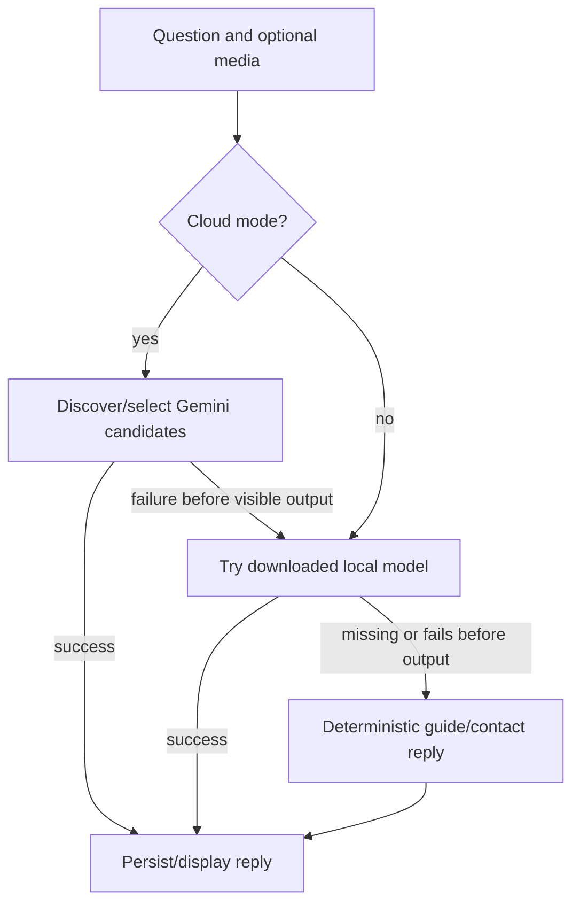

# AI and voice

## Dispatch and grounding

`src/services/assistant.ts` is the entry point. Current selectable modes are `local` and `cloud`.

After visible streaming begins, failures are surfaced for retry rather than silently replacing the answer. The dispatcher returns text, optional notices, selected model, usage, and context information. It accepts cancellation and stream callbacks.

Prompt building uses bundled guide keywords, English/Filipino contact terms, municipality/barangay matches, and the saved address/personal contact supplied by the chat screen. Directory questions receive a focused directory where possible. Photo/audio requests use dedicated prompts. Guide retrieval is deterministic keyword matching, not an embedding or vector-search system.

Only the last ten history messages are supplied by the dispatcher. Gemini receives text from prior messages and the current attachment, avoiding repeated image uploads. Local conversations can reuse native state; a new conversation reconstructs a bounded text transcript. System-prompt changes and high context utilization release the conversation.

## Cloud implementation

`gemini.ts` calls the Google GenerateContent streaming endpoint with SSE, a 60-second timeout, cancellation, mapped API errors, and usage extraction. `geminiModels.ts` lists accessible models, caches discovery for ten minutes, excludes unsuitable model families, and selects candidates based on modality and request complexity. Certain unavailable/quota/server errors can try another candidate before output begins.

`src/data/ai.ts` contains an app-maintained model catalog and preference order. These strings and cost labels express app assumptions, not independently verified provider availability or pricing. The usage dialog's limits are application counters, not provider quota enforcement.

There is no active custom OpenAI-compatible client. Legacy custom settings, token storage helpers, and usage schema remain for compatibility.

## Local model lifecycle

- Runtime: `react-native-litert-lm` 0.8.1 with Nitro Modules, not llama.rn.
- Artifact: Gemma 4 E2B `.litertlm`, declared size 2,588,147,712 bytes, downloaded from Hugging Face to `Paths.document/models`.
- States: missing, downloading, paused, downloaded, loading, ready, unsupported.
- Download service tracks progress, speed, ETA, partial file, and pause metadata; supports resume, cancel, and removal.
- Engine operations share a promise queue so settings cannot unload native state during generation.
- Load checks the exact artifact size, physical-device compatibility, available memory before model inspection, backend compatibility, and memory estimates. Size checking is not cryptographic integrity verification.
- Context limit is 4,096 tokens. Short/detailed dispatcher budgets are 320/900 output tokens. Local token usage is estimated from context and output length.
- Text-only loading avoids media encoders. A media request may require a more expensive multimodal reload. An already multimodal engine can serve text.
- Backend choices are auto/NPU/GPU/CPU; usable candidates and free memory determine selection. Selecting NPU does not guarantee NPU execution.

Android requires arm64 and API 26 or later plus the local module. iOS uses LiteRT memory readings and requires a physical device. Web explicitly reports local inference unsupported.

## Streaming and durable chat

`src/app/(tabs)/chat.tsx` saves user messages and pending assistant records, batches UI stream updates at approximately 50 ms, persists final/error states, records usage, and supports retry and stopping. Pending records left by interruption are recovered as errors on subsequent loading. Only completed history is used for generation. This persists visible conversation history separately from the ephemeral native model context.

## Attachments and speech

Photo attachment handling checks MIME type and size and requests camera/library access. Native files are persisted before use; capture-to-chat staging is an in-memory handoff. Voice recording uses optional `expo-audio` with a 120-second recording limit. It records audio for model analysis rather than using a speech-recognition dependency.

Local Android decoding accepts at most 30 seconds and converts compressed recordings into mono 16 kHz PCM WAV. Image preparation bounds decoded dimensions and writes temporary JPEGs. Canonical-path checks restrict native media inputs to app files/cache. Temporary converted media is deleted after inference. Local audio analysis on iOS is explicitly rejected by the current service; cloud audio is a separate path.

`voice.ts` uses `expo-speech` for optional assistant playback, voice selection, language preference, and stopping. It supports Filipino/English selection heuristics. Builds missing native audio/speech explain unavailable functionality instead of assuming every binary has the modules.
