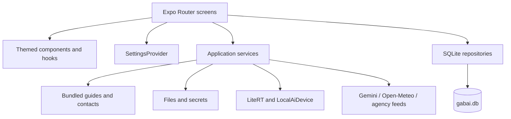

# Architecture

## Layers and dependencies

Screens coordinate interactions; repository functions receive the database explicitly. Services implement inference, media handling, location, speech, and network access. Static content is imported from `src/data/`. There is no central server database, remote login, or sync engine in the checked-in app.

## Startup

1. `expo-router/entry` loads `src/app/_layout.tsx`.
2. Browser startup obtains an origin-wide database lock before mounting SQLite. BroadcastChannel handoff pauses another tab so its SQLite worker releases file handles.
3. `SQLiteProvider` opens `gabai.db`; migrations enable WAL and apply pending migrations transactionally using `PRAGMA user_version`.
4. `SettingsProvider` loads settings asynchronously while showing a fallback. It renders children only after settings resolve, avoiding a theme flash.
5. The root navigator exposes onboarding or the protected application stack according to `settings.onboarded`.

Boot errors have dedicated reload/error states. Browser database waits expose an “Open in this tab” handoff after a timeout. Settings loading failure uses defaults; preference updates optimistically change memory before awaiting persistence.

## Presentation system

`src/theme/tokens.ts` owns colors, spacing, radii, type ramps, and text sizes. `useTheme()` combines the saved light/dark preference with the text-size scale. Current settings support light and dark; there is no active system-theme choice.

Use `src/components/ui/` primitives for consistent text, buttons, rows, cards, spacing, touch behavior, and screens. Feature components cover chat bubbles/input, model settings, onboarding, avatars, weather, and guide artwork. Hooks isolate keyboard visibility, reduced motion, and public-update loading.

## Platform boundaries

Metro resolves `.web.ts` siblings for filesystem-dependent storage, secrets, local AI, device information, dialogs, speech, and public updates. Matching interfaces allow screens to share imports. Browser persistence uses SQLite web support and data URIs for attachments; native persistence uses app-private files. Web secrets use localStorage.

`metro.config.js` registers WASM assets and adds COEP/COOP headers in development. `app.json` also configures Router headers. Production web hosting must preserve the required behavior; the existence of development middleware alone does not configure an arbitrary host.

## Native extension

`modules/local-ai-device/` is an Android-only local Expo module. Kotlin provides available-memory/storage readings, ABI/API compatibility checks, hardware discovery, bounded image decoding, and audio conversion. C++ probes NNAPI devices and OpenCL availability. Hardware presence does not prove the downloaded model can run on that accelerator; LiteRT recommendations and memory estimates decide the usable backend.

`patches/react-native-litert-lm+0.8.1.patch` adds Android consumer keep rules for JNI-discovered classes. `postinstall` applies it through patch-package. Configuration also includes LiteRT keep rules in `app.json`; both are part of native release correctness.
